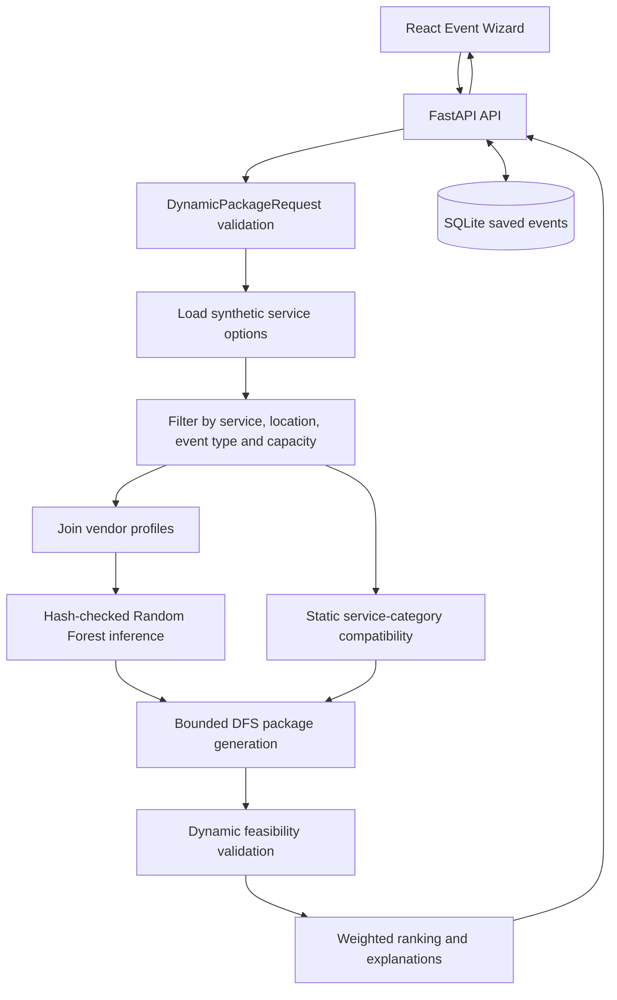

# PlanoVision: Vendor Intelligence & Smart Package Recommendation Engine

**Research project:** PlanoVision --- Smart Integrated Event Planning and Business Intelligence System  
**Component:** Vendor Intelligence & Smart Package Recommendation Engine  
**Group ID:** J26-IT-383  
**Research stage:** PP1 implementation completed; PP2 and final research preparation

> This README is a component-specific research document. It describes the implementation and evidence currently present in this repository. It does not claim live vendor availability, confirmed quotations, observed vendor collaboration, or real-world model reliability.

## 1. Project overview

The Vendor Intelligence component generates event-service packages from event requirements such as:

- event type;
- date and time;
- city and state;
- guest count;
- budget; and
- required service categories.

The current request-time workflow filters service options, obtains profile-based vendor risk signals, applies service-category compatibility rules, searches bounded combinations of distinct vendors, validates each complete combination, ranks eligible packages and returns explanations and verification requirements.

The implementation is a supervised academic research prototype. Its service-option prices, capacities, simulated locations, availability and collaboration records are synthetic or simulation-derived unless explicitly identified otherwise in the data provenance files.

## 2. Research problem

Event planning requires multiple vendors to satisfy several constraints simultaneously. Selecting vendors independently can produce packages that:

- omit a required service;
- use the same vendor more than once;
- exceed the event budget;
- exceed simulated guest capacity;
- do not support the event type or location; or
- appear feasible without event-specific availability, scheduling, venue or collaboration evidence.

The research problem is therefore to construct a transparent, computationally bounded package recommendation workflow that combines candidate selection, vendor signals, compatibility information, feasibility checking and multi-criteria ranking.

## 3. Research objectives and contribution

### Objectives

1. Generate packages covering the requested service categories.
2. Enforce distinct-vendor, event-type, location, capacity and budget constraints where source data supports them.
3. Integrate an auditable vendor risk signal derived from profile/review features.
4. Represent known and unknown service-category compatibility.
5. Avoid unbounded Cartesian-product search using candidate and node limits.
6. Validate complete combinations before ranking them.
7. Return transparent score components, warnings, evidence scope and missing verification requirements.
8. Evaluate the proposed ranking against a cost-only baseline on an identical examined package pool.

### Implemented contribution

The implemented contribution is the integration of:

- candidate filtering;
- hash-checked Random Forest inference;
- static category compatibility scoring;
- bounded depth-first package search;
- synthetic feasibility validation;
- weighted ranking; and
- deterministic recommendation explanations.

### Novelty claim and boundary

The defensible novelty claim is an integrated and transparent bounded search-and-ranking workflow for synthetic event-vendor package construction. The current evidence does not support claims of:

- novel real-world vendor-risk prediction;
- live vendor intelligence;
- verified vendor collaboration;
- globally optimal package selection; or
- production-ready recommendation reliability.

## 4. Current implementation status

| Area | Status | Evidence |
|---|---|---|
| FastAPI backend and route registration | **IMPLEMENTED** | `backend/main.py`, `backend/api/` |
| React frontend and API integration | **IMPLEMENTED** | `frontend/src/`, `frontend/src/services/api.js` |
| Synthetic service-option loading | **IMPLEMENTED** | `backend/engine/package_data_loader.py` |
| Candidate filtering | **IMPLEMENTED** | `backend/engine/candidate_selection.py` |
| Random Forest inference | **IMPLEMENTED** | `backend/engine/risk_signals.py` |
| Category compatibility heuristic | **IMPLEMENTED** | `backend/engine/service_compatibility.py` |
| Bounded package search | **IMPLEMENTED** | `backend/engine/bounded_package_generator.py` |
| Feasibility checks | **IMPLEMENTED for available synthetic evidence** | `backend/engine/dynamic_feasibility.py` |
| Weighted ranking and explanations | **IMPLEMENTED** | `backend/engine/bounded_package_generator.py`, `package_explanations.py` |
| Live quotation and availability verification | **NOT IMPLEMENTED / NOT VERIFIED** | No live connector or confirmed evidence found |
| NLP sentiment-enhanced risk | **PLANNED** | No integrated NLP model found |
| Independent real-world validation | **NOT VERIFIED** | No independent outcome dataset found |

## 5. Technologies

| Layer | Verified technology |
|---|---|
| Frontend | React 19, React DOM, Vite, oxlint |
| Backend | FastAPI, Pydantic v2, pandas, SQLite |
| Machine learning | scikit-learn `RandomForestClassifier`, persisted with joblib |
| Data storage | CSV research/simulation files and SQLite saved events |
| API communication | Browser `fetch`; Vite proxies `/api` and `/health` to `127.0.0.1:8000` |
| Currency transformation | Fixed simulation conversion `USD_TO_LKR = 330.777` |

Evidence sources include [frontend/package.json](frontend/package.json), [frontend/vite.config.js](frontend/vite.config.js), [backend/main.py](backend/main.py), [backend/db.py](backend/db.py), [backend/engine/package_data_loader.py](backend/engine/package_data_loader.py), and [research_evaluation/evaluation_summary.json](research_evaluation/evaluation_summary.json).

No root `requirements.txt`, `pyproject.toml`, Conda environment file, Dockerfile or backend packaging manifest was found. Python dependencies are therefore not installable from one verified root dependency command in the current repository.

## 6. Architecture



### Request-time workflow

1. The frontend obtains supported simulated locations.
2. The user submits event requirements to `POST /api/packages/generate-dynamic`.
3. Pydantic validates event type, date, time, location text, guest count, budget, services and `top_k`.
4. The backend loads current synthetic service options.
5. Candidate options are filtered by service category, simulated location, supported event type and catering capacity.
6. Vendor profile rows are joined by `business_id` and passed through the verified local model when inputs are complete.
7. Service-category compatibility is calculated from the static compatibility matrix.
8. Bounded DFS searches distinct-vendor combinations under budget and search limits.
9. Every complete examined combination is checked by the dynamic feasibility engine before ranking.
10. Packages are ranked, explained and returned with warnings and search metadata.
11. The frontend can submit a returned package to `POST /api/feasibility/validate-dynamic` for source-record validation.

The frontend also saves user-entered events in SQLite before dynamic generation. The vendor-demo CRUD routes are local demonstration routes and are not shown in the source to feed the recommendation engine's source-option table.

## 7. Algorithms

### 7.1 Candidate selection

Implemented in [backend/engine/candidate_selection.py](backend/engine/candidate_selection.py).

For each requested service, the selector filters rows by:

- exact service category;
- case-insensitive simulated city and state;
- event type membership in `supported_event_types`; and
- guest capacity for catering where `max_guests` applies.

The selector returns one candidate DataFrame per requested service. It scans the option table for each service, so its practical cost depends on the option-table size and number of requested services.

### 7.2 Random Forest vendor risk signal

Implemented in [backend/engine/risk_signals.py](backend/engine/risk_signals.py).

Input features:

```text
stars
review_count
collected_review_count
mean_review_rating
rating_std
```

The loader verifies:

- model SHA-256;
- feature order;
- class order: `High`, `Low`, `Medium`;
- target name: `risk_level`; and
- package label type: `rule-derived`.

Profile IDs must be unique and model features must be complete. Missing, duplicate or incomplete matches remain unknown rather than being assigned a fabricated score.

The ranking convention in the current implementation is:

| Rule-derived label | Score used by ranking |
|---|---:|
| Low | 100 |
| Medium | 60 |
| High | 20 |

This means a larger value is treated as a more favourable **rule-derived low-risk signal**. It is not a measured probability of vendor success, safety or reliability.

### 7.3 Service compatibility

Implemented in [backend/engine/service_compatibility.py](backend/engine/service_compatibility.py).

The engine loads `vendor_compatibility_matrix.csv`, evaluates unordered pairs of service categories and averages known pair scores. If any pair is unknown, the package-level compatibility score is omitted and the status is `partial` or `unknown`.

The matrix describes service-category heuristics. It is not evidence that the selected vendors have worked together. For a fixed event, compatibility can be constant across all packages because it depends on service categories rather than vendor identity.

### 7.4 Bounded DFS package generation

Implemented in [backend/engine/bounded_package_generator.py](backend/engine/bounded_package_generator.py).

The generator:

1. validates and prices eligible options;
2. selects at most 12 candidates per service by default;
3. reserves candidate slots for low-cost and high rule-derived-risk options;
4. orders service groups by candidate-group size;
5. recursively chooses one option per service;
6. rejects duplicate vendors;
7. rejects partial totals above the budget;
8. stops at 5,000 search nodes by default;
9. validates complete combinations; and
10. retains at most `top_k` results.

The environment variables `PLANOVISION_MAX_CANDIDATES_PER_SERVICE` and `PLANOVISION_MAX_SEARCH_NODES` can change the limits. The search does not materialise the full Cartesian product, but the bounded result is not guaranteed to be globally optimal. The API exposes truncation and search metadata.

### 7.5 Feasibility checking

Implemented in [backend/engine/dynamic_feasibility.py](backend/engine/dynamic_feasibility.py).

The engine checks service coverage, unique vendors, event duration, event type, simulated location, synthetic price, simulated capacity and budget. Availability, scheduling, vendor collaboration and venue suitability are represented as pending verification requirements because the required event-specific evidence is absent.

The dynamic feasibility route additionally resolves submitted service-option IDs against current source records and rejects altered material fields. This protects the analytical estimate from client-submitted prices; it is not vendor identity or booking attestation.

### 7.6 Weighted ranking

Default weights are:

| Component | Weight |
|---|---:|
| Cost | 0.4 |
| Rule-derived risk | 0.4 |
| Compatibility | 0.2 |

The ranking uses:

```text
cost component = 1 - total_cost / budget
risk component = mean_rule_risk_score / 100
compatibility component = known_compatibility_score / 100
final score = 100 * weighted mean of available components
```

Unknown components are omitted and the remaining weights are renormalised. Packages prioritise `PASS_IN_SIMULATION`, then ranking score, then lower cost and deterministic option IDs. Ranking factors and explanations are returned in the response.

## 8. Repository structure

```text
Vendor-Intelligence-System/
--------- backend/
---   --------- main.py                         FastAPI app and router registration
---   --------- db.py                           SQLite saved-event persistence
---   --------- vendor_demo_db.py               Vendor-demo persistence
---   --------- api/
---   ---   --------- packages.py                 Package generation routes
---   ---   --------- feasibility.py              Feasibility routes
---   ---   --------- events.py                   Saved and legacy event routes
---   ---   --------- locations.py                Simulated location route
---   ---   --------- admin.py                    Research/admin routes
---   ---   --------- vendor_demo.py               Vendor-demo CRUD routes
---   --------- engine/
---   ---   --------- dynamic_package_service.py Request-time orchestration
---   ---   --------- candidate_selection.py      Candidate filtering
---   ---   --------- bounded_package_generator.py Bounded DFS and ranking
---   ---   --------- dynamic_feasibility.py      USER-event feasibility
---   ---   --------- risk_signals.py             Model loading and inference
---   ---   --------- service_compatibility.py    Category-pair scoring
---   ---   --------- package_explanations.py     Explanation generation
---   ---   --------- package_data_loader.py      CSV loading and currency conversion
---   --------- schemas/                        Pydantic request/response models
--------- frontend/
---   --------- package.json                    React/Vite scripts and dependencies
---   --------- package-lock.json               Locked frontend dependencies
---   --------- src/                            UI pages, API client and view models
--------- hybrid_simulation_v1/               Simulation datasets and provenance
--------- data/cleaned/                       Checked model source data
--------- models/                             Persisted Random Forest artifact
--------- notebooks/                          Dataset audit notebook
--------- research_evaluation/                Evaluation code, metrics and reports
--------- research_data_v2/                   PP1 evidence and validation artifacts
--------- tests/                              Python tests
--------- final_validation/                   Existing validation reports
--------- docs/                               Research documentation
```

## 9. API reference

Routes are registered in [backend/main.py](backend/main.py) and implemented under [backend/api/](backend/api/).

| Method | Endpoint | Purpose | Request/response evidence |
|---|---|---|---|
| GET | `/` | Application status | JSON status in `backend/main.py` |
| GET | `/health` | API health | JSON health response |
| GET | `/api/events` | List saved events | SQLite event list |
| POST | `/api/events` | Save an event | `EventRequest`; HTTP 201 |
| GET | `/api/events/{event_id}` | Read saved or legacy synthetic event | Event wrapper; 404 when absent |
| PUT | `/api/events/{event_id}` | Update saved event | `EventRequest`; 404 when absent |
| DELETE | `/api/events/{event_id}` | Delete saved event | HTTP 204; 404 when absent |
| POST | `/api/packages/generate` | Generate packages for an existing synthetic event | `PackageGenerationRequest`, `PackageGenerationResponse` |
| POST | `/api/packages/generate-dynamic` | Generate packages from current user requirements | `DynamicPackageRequest`; dynamic generation response |
| POST | `/api/feasibility/validate` | Legacy synthetic feasibility validation | `FeasibilityInput`, `FeasibilityResponse` |
| POST | `/api/feasibility/validate-dynamic` | Validate a `USER-*` event and source-bound options | Dynamic event/options payload; HTTP 422 for invalid or altered options |
| GET | `/api/locations` | List supported simulated locations | Location list with `data_origin` |
| GET | `/api/admin/summary` | Research/admin summary | Evaluation and dataset summary; unauthenticated demo |
| GET | `/api/admin/vendors` | Search and paginate vendor profiles | Query filters and paged records |
| GET | `/api/admin/service-options` | Search and paginate service options | Query filters and paged records |
| GET | `/api/vendor-demo/dashboard` | Vendor portal demo dashboard | Local demo data |
| GET/PUT | `/api/vendor-demo/profile` | Read/update demo profile | `ProfileRequest` for update |
| GET/POST/PUT/DELETE | `/api/vendor-demo/services[/{service_id}]` | Demo service CRUD | `ServiceRequest` for create/update |
| GET/POST/PUT/DELETE | `/api/vendor-demo/availability[/{availability_id}]` | Demo availability CRUD | Availability schema in `vendor_demo.py` |

Authentication and authorisation are not implemented for the academic admin/vendor-demo routes. These routes should not be treated as production-secure APIs.

## 10. Installation and setup evidence

### 10.1 Frontend setup --- verified from project files

The frontend contains `package.json` and `package-lock.json`. From the repository root:

```powershell
cd frontend
npm ci
npm run dev
```

The verified scripts in [frontend/package.json](frontend/package.json) are:

```text
npm run dev       # Vite development server
npm run build     # Vite production build
npm run lint      # oxlint
npm run preview   # Vite preview server
```

The Vite development server is configured for `127.0.0.1:5173` and proxies `/api` and `/health` to `http://127.0.0.1:8000`.

### 10.2 Backend setup --- partially verified

The existing [final_validation/demo_walkthrough.md](final_validation/demo_walkthrough.md) records this local command:

```powershell
.\venv\Scripts\python.exe -m uvicorn backend.main:app --host 127.0.0.1 --port 8000
```

This is a historical project walkthrough command, not a fresh execution result from this README preparation. The repository does not provide a root dependency manifest or canonical environment-creation script. The available saved runtime metadata records Python 3.13.8, FastAPI 0.143.0, Pydantic 2.14.1, pandas 3.0.6, scikit-learn 1.9.1, joblib 1.6.0 and uvicorn 0.54.0.

The SQLite event table is created automatically by [backend/db.py](backend/db.py) when event operations call `init_db()`. No separate migration command was found.

### 10.3 Model loading

The model is loaded on demand by [backend/engine/risk_signals.py](backend/engine/risk_signals.py). The loader verifies the model artifact hash and metadata before inference. The model is not retrained during application startup.

### 10.4 Testing instructions and evidence

The existing validation report records:

```powershell
.\venv\Scripts\python.exe -m unittest discover -s tests -v
.\venv\Scripts\python.exe -m unittest tests.test_final_validation -v
```

The same report states that these historical runs produced 43 tests with zero failures/errors and 9 focused tests passing. It also records a successful historical `npm run build`. These results were not rerun during preparation of this draft and should be treated as persisted project evidence rather than a current execution guarantee.

Relevant test files include:

- `tests/test_dynamic_packages.py`;
- `tests/test_dynamic_feasibility.py`;
- `tests/test_risk_compatibility.py`;
- `tests/test_no_match_diagnostics.py`;
- `tests/test_research_evaluation.py`; and
- `tests/test_final_validation.py`.

## 11. Dataset and provenance

The simulation manifest [hybrid_simulation_v1/dataset_manifest.json](hybrid_simulation_v1/dataset_manifest.json) records:

| Dataset | Rows | Status |
|---|---:|---|
| `real_vendor_profiles.csv` | 18,430 | Profile/review-feature table; risk fields are derived |
| `synthetic_service_options.csv` | 57,549 | Synthetic service, pricing, capacity and location options |
| `synthetic_event_requirements.csv` | 30 | Synthetic event templates |
| `synthetic_availability.csv` | 191 | Synthetic availability scenarios |
| `synthetic_collaboration_scenarios.csv` | 330 | Synthetic collaboration scenarios, not observed collaboration |
| `hybrid_vendor_service_dataset.csv` | 57,549 | Hybrid simulation table |

The field provenance file identifies profile names, locations and review fields as profile/review-feature data, while service-option fields such as price, tier, capacity and simulated location are simulation metadata. The manifest explicitly warns that synthetic prices, capacities, service areas, backup capability, availability and collaboration are not vendor facts.

The package loader transforms simulated USD values into LKR using the fixed value `330.777`. This is a simulation conversion, not a current exchange-rate or quotation claim.

## 12. Machine-learning evaluation

The persisted evaluation describes a reconstructed notebook holdout from `data/cleaned/vendor_profiles_missingness_checked.csv`:

- total profile rows: 18,430;
- training rows: 14,744;
- reconstructed test rows: 3,686;
- split: `test_size=0.20`, `random_state=42`, stratified;
- features: `stars`, `review_count`, `collected_review_count`, `mean_review_rating`, `rating_std`;
- classes: `High`, `Low`, `Medium`; and
- model artifact: `models/vendor_risk_random_forest.pkl`.

Reported metrics:

| Metric | Reported value |
|---|---:|
| Accuracy | 1.0000 |
| Macro precision | 1.0000 |
| Macro recall | 1.0000 |
| Macro F1 | 1.0000 |
| Weighted F1 | 1.0000 |

Reported class supports are High 576, Low 408 and Medium 2,702, with a diagonal confusion matrix.

These metrics measure prediction of deterministic review-feature-derived labels. They do not measure prediction of independently observed vendor failures, cancellations, service quality or booking outcomes. Potential label leakage and circular evaluation substantially limit external validity. Original held-out row IDs were not separately persisted, so the holdout is reconstructed from the notebook split recipe and unchanged ordered input.

## 13. Package recommendation evaluation

The saved research evaluation used 30 existing synthetic event templates plus 5 additional synthetic scenarios, for 35 requests. It preserved the production candidate cap of 12 options per service, the 5,000-node limit, top-K 10 and feasibility ordering.

Reported results:

| Measure | Reported result |
|---|---:|
| Requests evaluated | 35 |
| Returned recommendations | 202 |
| Required-service coverage among returned packages | 100% |
| Budget-feasible rate among returned packages | 100% |
| Feasibility statuses | 202 `VERIFICATION_REQUIRED` |
| Complete combinations examined | 4,653 |
| Search truncation frequency | 57.14% (20/35) |
| Recommendation yield rate | 74.29% |
| HTTP request success rate | 97.14% |
| Mean/median/p95 TestClient time | 1,986.38 / 1,964.34 / 3,181.12 ms |

These are saved local TestClient measurements for synthetic scenarios. They are not deployed latency, throughput, concurrent-load results or real-world recommendation outcomes.

### Baseline comparison

The proposed ranking was compared with cost-only reranking on an identical examined and validated package pool. Across 26 comparable events:

- mean top-K overlap: 0.7115;
- mean absolute rank shift among shared packages: 1.7392 positions; and
- proposed-minus-baseline mean recommendation cost difference: +LKR 77,258.32.

The shared pool makes the ranking comparison controlled conditional on the production candidate policy. It does not demonstrate superiority over the complete vendor universe or establish user benefit.

## 14. PP1 completed work

The repository provides evidence for the following PP1 work:

- FastAPI application and route registration;
- React event-planning interface and API client;
- SQLite saved-event persistence;
- synthetic service-option and profile loading;
- candidate filtering by service, location, event type and applicable capacity;
- verified model artifact loading and profile joins;
- rule-derived risk scoring;
- category compatibility scoring with explicit unknown states;
- bounded DFS package generation;
- budget and duplicate-vendor pruning;
- synthetic feasibility checks before ranking;
- source-record validation for dynamic feasibility submissions;
- weighted ranking and deterministic explanations;
- admin and vendor-demo research interfaces;
- test files for recommendation, feasibility, model/compatibility and edge cases; and
- persisted evaluation, baseline and sensitivity reports.

## 15. PP2 and final research plan

The following are proposed developments, not current implementation claims:

1. **Independent outcome data:** collect consented, timestamped vendor quotations, availability, capacity, travel, venue suitability, collaboration evidence and completed-event outcomes.
2. **NLP sentiment enhancement:** define an annotation policy, extract sentiment features from permitted review text, and compare against the existing rule-derived model without circular labels.
3. **Improved requirement matching:** support structured service requirements and evaluate ambiguous, incomplete and conflicting requirements.
4. **Constraint optimization:** compare bounded DFS with a constraint solver or neutral full-universe baseline and report optimality gaps/search regret.
5. **Explainability:** distinguish hard constraints, observed evidence, derived scores and unknown verification requirements in the recommendation explanation.
6. **Adaptive reconfiguration:** allow users to change budget, services or constraints and regenerate packages while revalidating every affected condition.
7. **API integration:** add authenticated vendor/API connectors with freshness, provenance, authorization, rate limiting and failure handling.
8. **Final validation:** use a frozen external test set, independent labels, ablations, confidence intervals, calibration, subgroup analysis, browser testing and concurrent deployment benchmarks.

## 16. Limitations and research validity concerns

### Data validity

- Synthetic prices are not confirmed quotations.
- Synthetic locations, capacity, availability and collaboration do not prove vendor facts.
- No venue, safety, tax, travel-fee or complete scheduling validation is implemented.
- No vendor-specific free-text inclusions are supplied in the simulation manifest.

### Model validity

- The target is derived from related review features.
- Perfect holdout metrics can reflect rule imitation or label leakage.
- There is no independent real-world outcome label or external validation set.
- Risk scores are ranking signals, not calibrated operational-risk probabilities.

### Recommendation validity

- Candidate and node limits can omit a better package.
- Returned-package coverage and budget rates do not measure all possible combinations.
- The category compatibility score may be constant within one event.
- The saved baseline comparison is conditional on a shared, production-selected pool.

### Operational validity

- TestClient timings do not represent deployed network latency or throughput.
- No concurrency/load benchmark, security assessment, fairness study or user study is evidenced.
- Admin and vendor-demo routes are not authenticated or production-secured.
- Browser workflow verification is not claimed by this README.

## 17. Evidence map

- Application entry point: [backend/main.py](backend/main.py)
- API routes: [backend/api/](backend/api/)
- Request/response models: [backend/schemas/](backend/schemas/)
- Recommendation engine: [backend/engine/](backend/engine/)
- Frontend integration: [frontend/src/services/api.js](frontend/src/services/api.js)
- Simulation manifest: [hybrid_simulation_v1/dataset_manifest.json](hybrid_simulation_v1/dataset_manifest.json)
- Model evaluation: [research_evaluation/model_evaluation.md](research_evaluation/model_evaluation.md)
- Recommendation evaluation: [research_evaluation/research_results_report.md](research_evaluation/research_results_report.md)
- Evaluation metrics: [research_evaluation/evaluation_summary.json](research_evaluation/evaluation_summary.json)
- Existing test report: [final_validation/test_results.md](final_validation/test_results.md)
- Technical audit: [docs/COMPONENT_TECHNICAL_AUDIT.md](docs/COMPONENT_TECHNICAL_AUDIT.md)
- Research draft: [docs/README_RESEARCH_DRAFT.md](docs/README_RESEARCH_DRAFT.md)

## 18. Readiness statement

The component is suitable for a supervised academic demonstration of synthetic, transparent vendor-package recommendation. It is not production-ready. The current evidence does not justify claims of live vendor verification, real-world vendor-risk prediction, confirmed availability, observed collaboration or globally optimal recommendations.

This file is a final draft for **IT Checklist 1 --- By PP1 Presentation: Git Repository README.md file**. The root `README.md` has intentionally not been overwritten.


