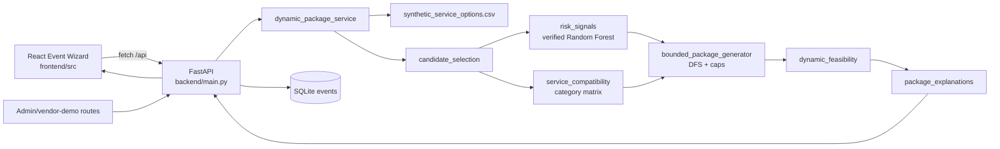

# Vendor Intelligence & Smart Package Recommendation Engine — Technical Audit

**Project:** PlanoVision
**Group:** J26-IT-383
**Audit scope:** the Vendor Intelligence component only
**Audit basis:** read-only inspection of source, configuration, datasets, persisted evaluation artifacts, and tests in this workspace. Tests and builds were not executed during this audit.

## 1. Executive conclusion

The repository contains a functioning research prototype with two package-generation paths:

1. A legacy synthetic-event path, `POST /api/packages/generate`.
2. A request-time user path, `POST /api/packages/generate-dynamic`, which filters synthetic service options, joins vendor profiles, invokes a hash-checked Random Forest, performs bounded package search, validates each complete combination, ranks surviving packages, and returns explanations.

The strongest evidence supports a supervised academic demonstration of a synthetic recommendation workflow. It does **not** support claims of live vendor availability, confirmed quotations, observed vendor collaboration, or real-world risk prediction. The Random Forest’s perfect reconstructed holdout metrics measure agreement with deterministic review-feature-derived labels, not independently observed vendor outcomes.

Status vocabulary used below: **IMPLEMENTED** means visible in the current code path; **PARTIALLY IMPLEMENTED** means some components exist but evidence or integration is incomplete; **PLANNED** means a sensible next step not evidenced as implemented; **NOT VERIFIED** means the repository contains insufficient evidence for the claim.

## 2. Repository and scope findings

### 2.1 Verified top-level areas

| Area | Finding |
|---|---|
| `backend/` | FastAPI application, SQLite event store, API routers, schemas, recommendation/feasibility engines. |
| `frontend/` | React 19/Vite UI, API client, event wizard, recommendations, comparison, feasibility, admin and vendor-demo screens. |
| `hybrid_simulation_v1/` | Simulation manifest, real-profile table, synthetic service options, event templates, availability and collaboration scenario files. |
| `research_evaluation/` | Saved evaluation metrics, methodology, baseline comparison, sensitivity analysis and verification scripts. |
| `research_data_v2/` | PP1 audit, validation, evidence and presentation artifacts. These are evidence records, not automatically proof of a live deployment. |
| `tests/` | Python unit/integration-style tests for package search, feasibility, risk/compatibility and final validation. |
| `notebooks/` | `01_vendor_dataset_audit.ipynb`, the documented dataset/model-audit notebook artifact. |
| `models/` | `vendor_risk_random_forest.pkl` and model verification artifacts. |
| `data/`, `dataset/`, `outputs/`, `reports/`, `final_validation/` | Supporting datasets, generated outputs and audit reports. |
| `docs/` | Existing PDF documents only at audit start; this audit adds the two Markdown deliverables requested. |

An untracked nested directory, `J26-IT-383/`, is present at the workspace root. It was not treated as the authoritative source because the active Git worktree and the requested files are rooted at `D:\Vendor-Intelligence-System`.

### 2.2 Verified branch and remotes

Local Git inspection reported branch `Vendor-Package-Recommendation/ahinsi`, remote `origin` at `https://github.com/ahinsi/PlanoVision-Vendor-Intelligence.git`, and remote `target` at `https://github.com/fernandoshamod/J26-IT-383.git`. The worktree had an untracked `J26-IT-383/` directory before documentation generation.

## 3. Research problem, objectives and novelty

### Research problem

Given event type, date/time, location, guest count, budget and required service categories, the component must produce a small set of distinct-vendor service packages, account for rule-derived vendor signals and service-category compatibility, reject infeasible combinations, and expose why a package was ranked.

### Research gap addressed by this prototype

The implementation combines candidate filtering, a vendor risk signal, compatibility heuristics, bounded combinatorial search, feasibility checks and multi-criteria ranking in one request-time workflow. The gap claim is limited: the repository does not establish superiority over commercial systems or a complete vendor universe, and does not provide independent real-world outcome labels.

### Implemented contributions

- Request-time package construction for `USER-*` events in `backend/engine/dynamic_package_service.py`.
- Service/location/event-type/capacity candidate filtering in `backend/engine/candidate_selection.py`.
- Hash- and metadata-checked Random Forest inference in `backend/engine/risk_signals.py`.
- Service-category compatibility scoring in `backend/engine/service_compatibility.py`.
- Capped candidate selection and bounded depth-first search in `backend/engine/bounded_package_generator.py`.
- Pre-ranking synthetic feasibility checks and explicit pending verification requirements in `backend/engine/dynamic_feasibility.py`.
- Weighted transparent ranking and deterministic explanation generation in `backend/engine/bounded_package_generator.py` and `backend/engine/package_explanations.py`.
- React presentation and API integration in `frontend/src/App.jsx` and `frontend/src/services/api.js`.

### Proposed novelty and its boundary

The defensible novelty claim is an integrated, transparent, bounded search-and-ranking pipeline for synthetic event-vendor package construction. It is not defensible to claim novel risk prediction, live vendor intelligence, verified collaboration, or globally optimal package selection from the current evidence.

## 4. Technologies and algorithms

### Technologies

| Layer | Verified technology/evidence |
|---|---|
| Frontend | React 19, React DOM, Vite, `oxlint`; `frontend/package.json`. |
| Backend | FastAPI, Pydantic v2 schemas, pandas, SQLite, joblib; source imports and saved runtime metadata. |
| ML | scikit-learn `RandomForestClassifier`, persisted with joblib; `models/vendor_risk_random_forest.pkl`. |
| Persistence | SQLite database at `backend/planovision.db`, configurable with `PLANOVISION_DB_PATH`; `backend/db.py`. |
| Data | CSV files loaded by pandas; simulation data under `hybrid_simulation_v1/`. |
| Frontend/backend link | Browser `fetch` calls through Vite proxy to `127.0.0.1:8000`; `frontend/src/services/api.js`, `frontend/vite.config.js`. |

No root `requirements.txt`, `pyproject.toml`, Conda file, Dockerfile or backend packaging manifest was found at the inspected root. The exact backend installation/startup command is therefore **NOT VERIFIED** from repository configuration. The frontend scripts are verified from `frontend/package.json`.

### 4.1 Candidate filtering — IMPLEMENTED

`select_candidates_for_event` filters each requested service by exact service category, case-insensitive simulated city/state, event type membership, and catering guest capacity. It returns one DataFrame per requested service. The logic is in `backend/engine/candidate_selection.py`.

Limitation: filtering uses simulated service-area and capacity fields. Missing or non-applicable capacity is not equivalent to confirmed capacity. Candidate selection is linear in the option-table scan per requested service, apart from pandas operations.

### 4.2 Random Forest risk classification — IMPLEMENTED, but target validity is limited

`backend/engine/risk_signals.py` loads five features: `stars`, `review_count`, `collected_review_count`, `mean_review_rating`, and `rating_std`. It checks the model SHA-256, feature order, class order (`High`, `Low`, `Medium`), target name and `rule-derived` metadata. It joins requested `business_id` values to unique rows in `hybrid_simulation_v1/real_vendor_profiles.csv`, predicts only complete feature rows, and leaves missing/ambiguous/incomplete joins unknown.

The current ranking maps the profile’s rule-derived risk score as Low = 100, Medium = 60 and High = 20. Higher is therefore a more favorable rule-derived signal, not a measured probability of safety or success. The model is not retrained at runtime.

Complexity is approximately linear in the number of requested profiles plus model inference cost. The model artifact is cached after hash verification. Limitations are deterministic labels, feature/label leakage risk, lack of independent outcomes, and no external validation.

### 4.3 Compatibility scoring — IMPLEMENTED as a category heuristic

`backend/engine/service_compatibility.py` loads `vendor_compatibility_matrix.csv`, looks up every unordered pair of requested service categories, and averages scores only when all pairs are known. Any unknown pair makes the package-level score `None` (`partial` or `unknown`). The result explicitly states `is_vendor_collaboration_evidence: false`.

For a fixed event, compatibility depends on service categories, not selected vendor identities. Therefore it may be constant across all packages for that event and cannot by itself distinguish vendors.

### 4.4 Candidate reservation and bounded DFS — IMPLEMENTED

`backend/engine/bounded_package_generator.py` first validates and prices eligible options. Defaults are 12 candidates per service and 5,000 search nodes, configurable through `PLANOVISION_MAX_CANDIDATES_PER_SERVICE` and `PLANOVISION_MAX_SEARCH_NODES`. Candidate slots reserve approximately half for low cost, then high existing rule-derived risk score, then fill by cost; duplicate option IDs and, initially, duplicate vendor IDs are avoided.

The recursive search orders services by candidate-group size, rejects duplicate vendors and over-budget partial sums, and validates every complete examined combination with `validate_dynamic_package`. It retains at most `top_k` packages. The unbounded Cartesian space is `product(|C_i|)`; the implementation bounds traversal by candidate caps and node count, so worst-case explored nodes are capped but global optimality is not guaranteed.

### 4.5 Feasibility checking — IMPLEMENTED for synthetic evidence; real-world verification is pending

`backend/engine/dynamic_feasibility.py` checks service coverage, unique vendors, event duration, event type, simulated location, estimated price, simulated capacity, budget, availability, scheduling, pair collaboration and venue suitability. Essential event-specific evidence is marked `VERIFICATION_REQUIRED`; `FAIL` is returned if any failed check exists. The response states `is_real_world_feasible: false`.

The dynamic API additionally canonicalizes submitted option IDs against current source records and rejects altered material fields in `backend/api/feasibility.py`. This is an integrity safeguard for estimates, not proof of vendor identity or booking.

### 4.6 Weighted ranking — IMPLEMENTED

Default weights are cost 0.4, rule-derived risk 0.4 and compatibility 0.2. Cost is `1 - total_cost / budget`; risk is mean rule-risk score divided by 100; compatibility is the known score divided by 100. Unknown components are omitted and remaining weights are renormalized. The score is scaled to 0–100. Packages prioritize `PASS_IN_SIMULATION`, then descending score, then cost and option IDs.

The ranking is transparent but the risk and compatibility components are not independent real-world measurements. The formula and factors are returned in the package response.

## 5. Architecture and integration

The dynamic flow is: validate request schema → load current synthetic options → validate supported location → calculate duration → filter candidates → load verified model signals → calculate category compatibility → bounded search → feasibility before ranking → retain top-K → explanations/diagnostics → JSON response. The frontend saves an event in SQLite before requesting dynamic generation, then sends a returned package to the dedicated dynamic feasibility endpoint.

Integration with a larger PlanoVision system is not evidenced beyond local frontend/API routes. Vendor-demo CRUD is a local demonstration store and is not shown to feed the recommendation engine’s source records.

## 6. Data and ML audit

### Dataset evidence

`hybrid_simulation_v1/dataset_manifest.json` records 18,430 real-profile rows, 57,549 synthetic service options, 30 synthetic event requirements, 191 synthetic availability rows, and 330 synthetic collaboration scenarios. The manifest explicitly states that synthetic prices, capacities, service areas, backup, availability and collaboration are not vendor facts. The loader applies a fixed simulated USD-to-LKR conversion of 330.777 in `backend/engine/package_data_loader.py`.

Profile fields such as names, locations and review features are marked as user-supplied profile/review-feature origin; risk labels/scores are derived. Service-option metadata is marked synthetic/simulation origin, with a real `business_id` foreign key.

### Training/evaluation evidence

The saved research artifact reports the following reconstructed split from `data/cleaned/vendor_profiles_missingness_checked.csv`:

- 18,430 total profile rows; 14,744 train and 3,686 test rows.
- `train_test_split(test_size=0.20, random_state=42, stratify=y)`.
- Accuracy, macro precision, macro recall, macro F1 and weighted F1: 1.0000.
- Confusion matrix is diagonal: High 576, Low 408, Medium 2,702.
- Model metadata: 100 trees, five input features, scikit-learn 1.9.1 runtime artifact.
- Feature importance is available as an artifact under `research_data_v2/pp1_final_model_verification/feature_importance.csv`.

These numbers are reproducible as a reconstruction of the notebook recipe according to the saved reports, but this audit did not execute the evaluator. The original held-out row IDs were not separately persisted. The target is derived from related review features, so perfect performance is consistent with rule imitation or leakage. No independent real-world failure/quality outcome test exists in the inspected evidence.

### ML persistence and reproducibility

The production loader uses `models/vendor_risk_random_forest.pkl`, verifies SHA-256 `4eed170...aea3e6a` (full value is in `backend/engine/risk_signals.py` and `research_evaluation/evaluation_summary.json`), and checks metadata. Evaluation records seed 42, source hashes, runtime versions and configuration. No retraining command is documented as a verified repository entry point.

## 7. Package recommendation audit

| Concern | Current status and evidence |
|---|---|
| Candidate coverage | IMPLEMENTED for requested categories, simulated location/event support and eligible price/capacity records. |
| Budget | IMPLEMENTED through partial-sum pruning and cheapest-option precheck; prices are synthetic LKR estimates. |
| Vendor uniqueness | IMPLEMENTED in search and feasibility checks. |
| Risk integration | IMPLEMENTED, but only rule-derived signals; missing joins stay unknown. |
| Compatibility | IMPLEMENTED category-pair heuristic; not vendor collaboration evidence. |
| Bounded DFS | IMPLEMENTED with candidate/node caps and search metadata. |
| Feasibility before ranking | IMPLEMENTED for every complete examined combination. |
| Explanations | IMPLEMENTED as deterministic score/evidence/warning text. |
| Missing price/availability | Unpriceable options are excluded or pending; availability and scheduling remain pending. |
| Global optimum | NOT VERIFIED; saved evaluation reports 20 of 35 scenarios reached search truncation. |
| Live quotations/booking | NOT IMPLEMENTED/NOT VERIFIED. |

Failure cases are surfaced as no matching candidates, no budget-feasible combinations, no feasible combinations, or search-limit reached, with diagnostics when no package is returned.

## 8. API inventory

The actual routers are registered in `backend/main.py`.

| Method | Path | Source | Purpose / request | Response and status |
|---|---|---|---|---|
| GET | `/`, `/health` | `backend/main.py` | Service/root health | JSON status. |
| GET/POST | `/api/events` | `backend/api/events.py` | List or create saved `EventRequest` | SQLite event wrapper; POST 201. |
| GET/PUT/DELETE | `/api/events/{event_id}` | `backend/api/events.py` | Read, update or delete saved event; GET also reads legacy synthetic event | Event wrapper; 404 for missing; DELETE 204. |
| POST | `/api/packages/generate` | `backend/api/packages.py` | Legacy `PackageGenerationRequest` by synthetic event ID | `PackageGenerationResponse`; 404/422. |
| POST | `/api/packages/generate-dynamic` | `backend/api/packages.py` | `DynamicPackageRequest` for new requirements | Dynamic JSON with event, generation, audit and diagnostics; 422/503. |
| POST | `/api/feasibility/validate` | `backend/api/feasibility.py` | Legacy `FeasibilityInput` | `FeasibilityResponse`; 422 on engine input errors. |
| POST | `/api/feasibility/validate-dynamic` | `backend/api/feasibility.py` | USER event plus source-bound package options | Dynamic feasibility JSON; rejects non-USER IDs, unknown/changed options and wrong option count with 422. |
| GET | `/api/locations` | `backend/api/locations.py` | List simulated supported locations | `{data_origin, locations}`. |
| GET | `/api/admin/summary` | `backend/api/admin.py` | Research/admin summary | Counts, saved events and saved evaluation values; no authentication. |
| GET | `/api/admin/vendors` | `backend/api/admin.py` | Filter/page profile vendors | Paged vendor records. |
| GET | `/api/admin/service-options` | `backend/api/admin.py` | Filter/page synthetic options | Paged options and categories/locations. |
| GET/PUT | `/api/vendor-demo/profile` | `backend/api/vendor_demo.py` | Vendor-demo profile | Local demo DB record; schemas in source file. |
| GET/POST/PUT/DELETE | `/api/vendor-demo/services[/{service_id}]` | `backend/api/vendor_demo.py` | Vendor-demo service CRUD | Local demo DB records; 201/204 where declared. |
| GET/POST/PUT/DELETE | `/api/vendor-demo/availability[/{availability_id}]` | `backend/api/vendor_demo.py` | Vendor-demo availability CRUD | Local demo DB records; 201/204 where declared. |
| GET | `/api/vendor-demo/dashboard` | `backend/api/vendor_demo.py` | Vendor-demo dashboard | Aggregated local demo data. |

The frontend directly uses locations, dynamic generation, dynamic feasibility, saved events and vendor/admin routes in `frontend/src/services/api.js`. Authentication is explicitly disabled for the academic admin demo in `backend/api/admin.py`; production security is not implemented.

## 9. Testing and evaluation audit

Existing test files cover dynamic feasibility, dynamic package generation, final validation, no-match diagnostics, research evaluation and risk/compatibility. The saved `final_validation/test_results.md` reports 43 backend tests with zero failures and a successful frontend Vite build, but those results are historical artifacts and were not rerun for this audit.

Saved evaluation artifacts report 35 synthetic scenarios, 202 returned recommendations, 100% coverage and budget fit among returned packages, 202 `VERIFICATION_REQUIRED` results, 4,653 complete combinations examined, mean/median/p95 TestClient time 1,986.38/1,964.34/3,181.12 ms, and 20/35 scenarios truncated. These are local in-process measurements; they are not deployed latency, load, user-study or real-vendor measures.

The controlled cost-only baseline shares the examined validated package pool. Across 26 comparable events, mean top-K overlap was 0.7115 and the proposed-minus-baseline mean recommendation cost difference was +LKR 77,258.32. This is a conditional ranking comparison, not proof of user benefit.

No coverage report, concurrency benchmark, browser walkthrough, security assessment, fairness analysis or independently labelled external test set was verified.

## 10. PP1 status

### Completed / IMPLEMENTED

FastAPI routes, React workflow, SQLite saved-event CRUD, synthetic data loading, model inference safeguards, candidate filtering, bounded package generation, feasibility status reporting, weighted ranking, explanations, admin/vendor-demo views, research reports and focused test files.

### Partially implemented

Vendor intelligence is profile/review-feature based rather than live; risk is rule-derived; compatibility is category-level; availability/collaboration/venue/scheduling remain pending; global search is bounded; admin/vendor demo has no authentication; the frontend build is evidenced but a browser workflow is not independently verified by this audit.

### Planned or not verified

NLP sentiment, independent outcome labels, adaptive reconfiguration, verified quotations, live API connectors, production security, external validation, neutral full-universe benchmarking and deployment-scale performance.

## 11. PP2 and final research roadmap

1. Freeze a data contract separating observed, vendor-confirmed, simulated and derived fields; add provenance at row and field level.
2. Collect consented vendor quotations, availability, capacity, service areas, collaboration evidence and outcomes; preserve timestamps and source references.
3. Build NLP sentiment features only after defining annotation policy and an independent target; compare against the current rule-derived model without mixing labels.
4. Replace category compatibility with vendor- and event-specific evidence where available; represent unknown as unknown.
5. Add constraint-based optimization/solver benchmarking and report optimality gaps or search regret under caps.
6. Add explanation attribution that distinguishes hard constraints, observed evidence, derived scores and missing verification.
7. Implement adaptive package reconfiguration only with explicit user constraints and revalidation after every change.
8. Add authenticated, authorized and rate-limited APIs; bind feasibility checks to stored event/package revisions if persistence is required.
9. Evaluate on a frozen external set and real-world outcomes; include neutral full-universe baselines, ablations, confidence intervals, subgroup analysis and concurrent deployment benchmarks.

## 12. Audit limitations and unverified claims

This report did not execute tests or rebuild the frontend. It relies on source inspection and saved artifacts. Any claim that a current local run, browser interaction, dependency installation, live API, or real vendor confirmation succeeds remains **NOT VERIFIED** unless explicitly supported by a persisted artifact listed above. Synthetic data must not be presented as current vendor information, and rule-label accuracy must not be presented as real-world reliability.
